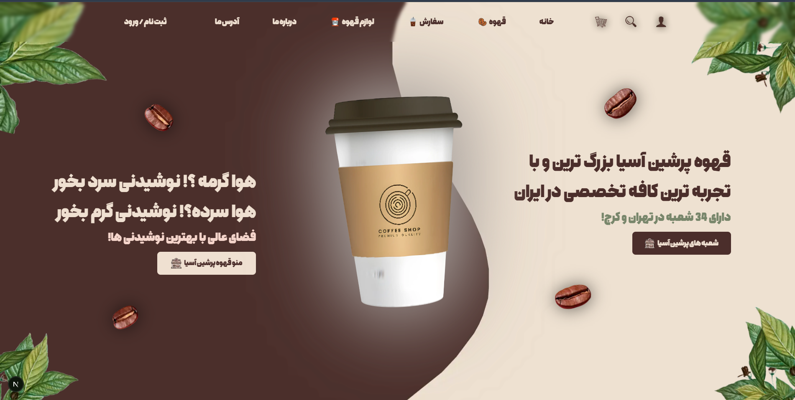

<p align="center">
  
</p>

# ☕ Coffee Shop 3D

## 🚧 Project Status: In Development

Coffee Shop 3D is an experimental frontend project created to explore the world of **3D web experiences, animations, and interactive interfaces**.

This project is not a commercial product. It is a personal learning project where I experiment with modern web technologies to improve my skills in creating high-performance 3D websites.

My goal is to understand the challenges of building 3D websites and gradually develop the ability to create immersive web experiences with smooth animations and optimized performance.

---

## ✨ Project Goals

- 🌐 Exploring 3D experiences on the web
- 🎨 Creating modern animated interfaces
- ⚡ Improving performance for complex visual experiences
- 🧩 Learning how to integrate 3D elements into real-world websites
- 🚀 Building a foundation for future advanced 3D projects

---

## 🛠️ Tech Stack

<div align="center">


</div>

### Libraries & Animation Tools

- 🎬 Framer Motion
- ⚡ GSAP
- 🧊 Three.js

---

## 🚀 Getting Started

### Installation

```bash
git clone https://github.com/Arsham-369-Ghaderi/Coffee-Shop-3D.git

cd Coffee-Shop-3D

npm install

npm run dev
